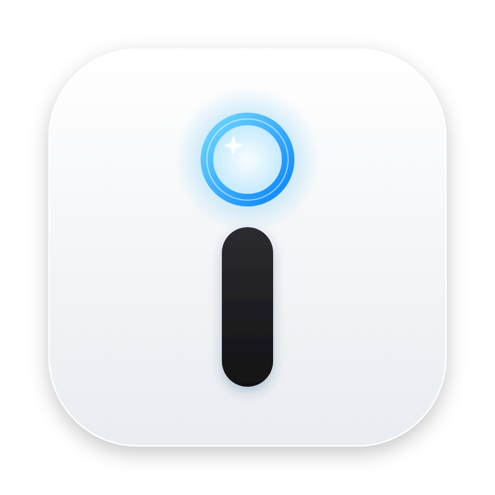

<div align="center">



# Glint · 瞳问

**看哪，问哪。眼睛找到那段，Joy-Con 定到那个词，千问直接知道你在问什么。**

[](#上手)
[](#上手)
[](#千问与端云协同)
[](#按键)
[](#功能)

**[下载 v0.1.1](https://github.com/LeoLee0812/Glint/releases/tag/v0.1.1)**：Mac `Glint-0.1.1-arm64.dmg` · Windows `Glint-Setup-0.1.1-x64.exe`

</div>

## 它做什么

Glint 是个桌面阅读程序。左边放论文 PDF、Markdown 或终端，右边是千问对话区。
摄像头看你的眼睛，两只 Joy-Con 一手一只。
提问时，你正在看的那段会自动带给模型，不用复制粘贴。

1. **看**：眼睛落在哪段，哪段就被光环圈住。
2. **定**：推右摇杆，把焦点定住，再推就按词、句、段挪。
3. **问**：A 解释，X 翻译，Y 总结，按住 ZR 直接说。
4. **答**：右边的回答已经带着那段原文和出处。

原名 LookAsk（看哪问哪），参加天猫 AI 黑客松·高校挑战赛「效率进化」赛道。

## 功能

- 读 PDF（扫描件也行）、Markdown、终端，粒度按 R 在词 / 句 / 段 / 节之间切。
- 关键词吸附：视线会被附近的术语、公式吸过去，摇杆一推就选中。
- 看不懂回答就再按 A，往下开一层解释卡片，B 一层层收回。
- 看图问：把当前一侧截图，圈出你在看的地方，交给看图模型。
- 终端里跑 Qwen Code，它等你批准时手柄会「心跳」，十字键放行。
- 震动当反馈，校准是个手柄小游戏，还有一个跟着你转头眨眼的卡通小人。
- Mac 版可以用 iPhone 原深感镜头做眼动，头动了也不容易偏。

## 千问与端云协同

回答、翻译、看图、画小人、终端编程智能体都用千问（阿里云百炼），回答也能换成本地的 `qwen3.5:4b`。

| 在本机 | 到云端 |
| --- | --- |
| 摄像头画面和眼动计算，从不上传 | 提问时那段文字和前后文 |
| iPhone 原深感数据，只在局域网里传 | 看图问、扫描页的屏幕截图 |
| Mac 语音识别、PDF 版面分析 | 你主动拍的那张大头照（生成小人用） |
| 可选：Ollama 跑本地千问 | Windows 的按住说话（百炼 Fun-ASR） |

## 按键

左手管左边内容，右手管右边 AI。没有手柄时用键盘兜底（Windows 把 `⌥` 换成 `Alt`）。

| 按键 | 作用 | 键盘 |
| --- | --- | --- |
| 左摇杆 | 滚动、翻页 | |
| 左十字键 | 文档里跳段；终端里当方向键、回车、Esc | |
| L | 切左侧标签页 | |
| 右摇杆 | 定住焦点，再推挪一格 | `⌥ + 方向键` |
| 右摇杆按下 | 跳回视线处；按住拧手腕精调 | |
| A / X / Y | 解释 / 翻译 / 总结 | `⌥↩` / `⌥T` / `⌥S` |
| ZR（按住） | 说话提问，松开发送 | 按住 `⌥空格`（Windows：`Alt+V`） |
| B | 放开焦点、停止回答 | `Esc` |
| R | 切粒度：词 → 句 → 段 → 节 | |
| − / + | 视线跟左边 / 右边 | |
| HOME | 显示 / 隐藏 Glint | |

## 上手

**Mac**（Apple 芯片，macOS 13+）

1. 打开 dmg，把 Glint 拖进「应用程序」。
2. 第一次右键 → 打开；提示「已损坏」就在终端跑 `xattr -cr /Applications/Glint.app`。
3. 给摄像头、麦克风、语音识别权限，在蓝牙里连上 Joy-Con (L) 和 (R)。
4. 跟着新手引导：连手柄 → 填百炼 API 密钥 → 校准 → 试一试。

**Android 平板**（Android 12+，横屏左右分屏，竖屏上下 7:3）

1. 安装 APK（`npm run build:android` 生成），在系统蓝牙里配对 Joy-Con。
2. Glint Eye 经 Type-C 扩展坞插 USB，平板没有终端和 iPhone 原深感，其余功能和桌面版相同。

**Windows**（10 / 11 x64）

1. 运行 exe 安装，SmartScreen 拦了就点「更多信息 → 仍要运行」。
2. 在「蓝牙和其他设备」里连上两只 Joy-Con；开着 Steam 的话先关掉它的 Switch 控制器支持。
3. 打开相机和麦克风的「让桌面应用访问」。
4. 跟着新手引导走。

API 密钥 在[阿里云百炼控制台](https://bailian.console.aliyun.com/cn-beijing/model/settings/api-key)创建（北京地域）。
本地模型：Mac 跑 `bash scripts/setup-local-model.sh`，Windows 装 Ollama 后 `ollama pull qwen3.5:4b`。

Windows 还可以把翻译和语音放到本地，没装时自动走云端：

- 本地翻译：装好 Ollama，从[魔搭](https://modelscope.cn/models/unsloth/Qwen3.5-2B-GGUF)下载 `Qwen3.5-2B-Q4_K_M.gguf`，改名 `qwen.gguf`，和 `scripts/qwen-mt.Modelfile` 放在同一目录，执行 `ollama create qwen3.5:2b-mt -f qwen-mt.Modelfile`
- 本地语音：把 [SenseVoice Small](https://hf-mirror.com/csukuangfj/sherpa-onnx-sense-voice-zh-en-ja-ko-yue-2024-07-17) 的 `model.int8.onnx` 和 `tokens.txt` 放进 `%APPDATA%\LookAsk\models\sensevoice`，重启 Glint

## 从源码构建

```bash
# Mac（需要 Xcode 命令行工具）
npm install
npm run build:native   # 编译 Swift 原生助手，开发前必须先跑
npm run dev            # 开发模式
npm run dist           # 打 arm64 dmg

# Windows（Node 22.12+）
npm install
npm run build:native   # 打包 TypeScript 版手柄助手
npm run dist:win       # 打 NSIS 安装包
```

iPhone 端 Glint Eye 用 `bash ios/LookAskEye/build.sh device` 装到手机。

## 架构

```
渲染进程（React）── preload ── 主进程（src/main）── 原生助手（Joy-Con / 语音 / 原深感收包）
                                                         ▲ UDP
                                                 iPhone Glint Eye（ARKit）
```

- `src/renderer/src`：眼动 `gaze`、焦点 `focus`、手柄 `input`、对话 `chat`、左侧视图 `panes`
- `native/LookAskBridge`（Swift，Mac）/ `native/win`（TypeScript，Windows）：原生助手
- `android/`：平板外壳（WebView + 原生桥），`src/renderer/src/android/install.ts` 拼出同样的 `window.lookask`
- `ios/LookAskEye`：iPhone 端；`docs/`：算法说明和实验

## 许可与致谢

仓库暂未附开源许可证。眼动特征来自 [RealEye Webcam EyeTracker Light Open](https://github.com/RealEye-io/webcam-eyetracker-light-open)（AGPL-3.0），再分发请注意。
还用到了 MediaPipe、pdf.js、xterm.js、node-pty、KaTeX、Qwen Code；Joy-Con 协议参考 dekuNukem，HD 震动移植自 joy-con-webhid。
Joy-Con 是任天堂的商标，iPhone 是 Apple 的商标，本项目与它们无关。
